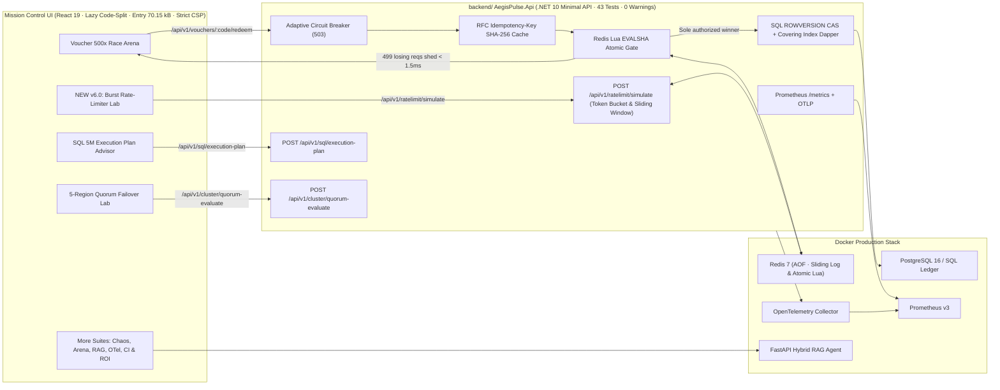

# AegisPulse Distributed SRE v6.0 — Con Cung 700-Store Flagship, Burst Rate-Limiter Lab, SQL 5M Plan & 5-Region Quorum

[](https://github.com/tvt987/aegispulse-distributed-sre/actions/workflows/ci-and-deploy.yml)
[](https://tvt987.github.io/aegispulse-distributed-sre/)
[](./backend)
[](./services/aegis-sre-agent-python)
[](./web/mission-control)
[](./docs/openapi.yaml)

> **Live Interactive Control Plane (Zero Cold-Start):** **[https://tvt987.github.io/aegispulse-distributed-sre/](https://tvt987.github.io/aegispulse-distributed-sre/)**
>
> Engineered by **Trương Văn Tình** — *Full-Stack .NET & Applied AI Solution Architect (3+ yrs high-concurrency retail ERP & e-commerce @ Con Cung Corporation — 700+ stores, 5,000+ RPS, 0.00% voucher double-spending)*.

---

## Why AegisPulse v6.0 Exists

Flash-sale voucher checkout systems across nationwide retail chains (`700+ stores`, `5,000+ RPS`, `5,000,000+` voucher rows) fail catastrophically under sudden contention due to five compounding failure modes:
1. **Gateway Fixed-Window 2x Boundary Spike Overflow**: Naive fixed-window counters reset at integer second boundaries, admitting **`2.00x` the gateway limit (`10,000 RPS` against a `5,000 RPS` cap)** when flash-sale bursts straddle window edges (`t = 4.5s..5.5s`) and saturating downstream SQL Server pools.
2. **TOCTOU Double-Spending (`SELECT` then `UPDATE`)**: Parallel threads read `Stock = 1` simultaneously and leak **14–38 double-spent `500,000 VND` vouchers** on a single promo campaign — scaling to billions of VND in direct margin loss across 700+ stores.
3. **Legacy EF Core Clustered Index Scans & Table Lock Escalation**: Unindexed `Vouchers + VoucherRedemptions` lookups scan **`14,200` logical pages** (`28.4 ms`, `125 MB` ChangeTracker heap) and trigger SQL Server `ROW -> TABLE` lock escalation under burst load.
4. **SQL Lock Convoy Collapse (`UPDLOCK`)**: Pessimistic row locking eliminates double-spending, but queues 499 waiting SPIDs sequentially, spiking **`p99 = 640ms`** and saturating **SQL Server CPU at `94%`**.
5. **Regional Split-Brain Dual-Writer Corruption**: Without strict 5-region Raft majority quorum (`>= 3/5`) and automatic **`READ_ONLY_FENCE`** enforcement on minority partitions, subsea fiber cuts allow two regions to approve the same voucher simultaneously.

**AegisPulse v6.0** is a full-stack, compiled, load-tested, and CI-verified production monorepo proving the complete Con Cung solution:
- **NEW v6.0 Token-Bucket vs Sliding-Window Log Rate-Limiter & Backpressure Lab (`RateLimiterLab.tsx` + `rateLimiterEngine.ts`)**: Models a `5,000 RPS` (`25 shards x 200 req/s`) flash-sale API gateway over a 20-second (`40 x 500ms`) timeline comparing **Fixed Window Counter** (exposing its Crimson `2.00x` boundary overshoot leak), **Token Bucket** (smooth burst absorption with live SVG Token Tank Gauge), and **Redis Sliding-Window Log** (strict `0` overshoot with RFC `HTTP 429` + `Retry-After` wire preview + live-parameterized copyable `.NET 10 AddRateLimiter` & Redis Lua scripts).
- **NEW v6.0 Visual Hierarchy & Navigation Ergonomics**: Datadog / Cloudflare Radar / Linear Dark & Crisp Daylight surface tokens, streamlined 5-core-lab segmented rail + `More Suites` popover, elevated tabular KPI typography, and immediate **Con Cung `700+ Stores · 5,000+ RPS · 0.00% Double-Spend`** hero proof on landing.
- **Expanded `.NET 10` Backend (`backend/AegisPulse.sln`)**: Real compiled ASP.NET Core 10 Minimal API + Domain engines featuring **`POST /api/v1/ratelimit/simulate`**, `POST /api/v1/sql/execution-plan`, `POST /api/v1/cluster/quorum-evaluate`, `POST /api/v1/vouchers/seed`, `POST /api/v1/vouchers/{code}/redeem`, `GET /api/v1/vouchers/{code}/audit`, `GET /api/v1/sre/cluster-status`, and `/metrics` — verified by **43 xUnit + `WebApplicationFactory<Program>` tests** (`0` compiler warnings with `TreatWarningsAsErrors=true`), including an in-process `.NET 10` throughput benchmark proving sustained **`> 5,000 ops/sec`** atomic redemption with `0` double-spends.
- **Complete v5.0 / v4.0 / v3.0 / v2.0 Interactive Suite Preserved**: 500-Request Voucher Race Arena, 5M-Row SQL Server Execution Plan & Dapper Index Advisor, 5-Region Raft Quorum Split-Brain Lab, 250K RPS Flamegraph, Incident Runbook Executor, OpenTelemetry Trace Waterfall, and Python 3.12 Hybrid RAG SRE Agent (`133/133` Vitest tests, entry JS `70.15 kB` `< 90 kB` via `React.lazy` + `manualChunks`, Strict CSP + `Referrer-Policy`, `0` UI emojis).

---

## System Architecture



---

## Verified Test Suites & Empirical Benchmarks

| Layer / Verification Suite | Command | Result | Key Proof |
| :--- | :--- | :--- | :--- |
| **`.NET 10` Voucher, Rate-Limiter, SQL Plan & Quorum API (`backend/`)** | `dotnet test backend/AegisPulse.sln -c Release` | **43 / 43 PASSED (`0` warnings)** | `15` new Rate-Limiter unit & HTTP integration tests (`POST /api/v1/ratelimit/simulate`), sustained `> 5,000 ops/sec` 10,000-op parallel benchmark (`0` double-spends), 50-way & 100-way HTTP races, SQL Plan & Quorum |
| **`.NET 10` Lock-Free Kernel (`services/`)** | `dotnet test services/aegis-kernel-dotnet/AegisKernel.sln -c Release` | **8 / 8 PASSED** | 1,000-way lock-free & 800-way CAS contention invariants + Live Kestrel HTTP test |
| **`Python 3.12` Hybrid RAG SRE Agent** | `cd services/aegis-sre-agent-python && pytest -v` | **5 / 5 PASSED** | `100%` Recall@1, `1.00` MRR, `100%` OOD zero-hallucination abstention (`p95 = 1.24ms`) |
| **`React 19 + TS` Mission Control** | `cd web/mission-control && npm test` | **133 / 133 PASSED** | `24` Rate-Limiter Lab + `13` SQL Plan + `13` 5-Region Quorum + `21` Voucher Race + `51` Raft/Flamegraph/Runbook/VietQR + `11` Kernel/RAG tests |
| **Vite Code-Split Production Build** | `cd web/mission-control && npm run build` | **0 Errors · `70.15 kB` Entry JS** | Entry chunk `70.15 kB` (`21.29 kB` gzip `< 90 kB`), lazy `RateLimiterLab` (`41.37 kB`), `VoucherRaceArena` (`38.31 kB`), `SqlPlanAdvisorLab` (`30.66 kB`) |
| **Headless Playwright E2E QA** | `1440x900` Desktop & `390x844` Mobile | **0 Errors · 0px Overflow** | Verified 2x Boundary Flash-Sale Spike (Fixed-Window `+400` overshoot vs Sliding-Window `0` overshoot), Daylight/Obsidian toggle, SQL Plan, 5-Region Quorum `READ_ONLY_FENCE`, Voucher Race & Strict CSP |

### 20-Second Gateway Burst Rate-Limiter Benchmark (`25 Shards x 200 req/s = 5,000 RPS Cap`, `600 req/s` 2x Boundary Spike)

| Rate-Limiting Algorithm | Peak Rolling 1s / Shard | Cluster Peak RPS | Boundary Overshoot Leak | Backpressure Mechanism | Production Verdict |
| :--- | :---: | :---: | :---: | :--- | :--- |
| **Fixed Window Counter** | **`400 req/s` (`2.00x`)** | **`10,000 RPS`** | **`+400 / shard` (`+10,000` cluster)** | Coarse reset at integer seconds | **VULNERABLE** — 2x boundary flood saturates SQL pool |
| **Token Bucket (`240` cap, `200/s`)** | `340 req/s` (bounded burst) | `8,500 RPS` peak, `5,000 RPS` steady | **`0`** | Smooth token tank burst absorption + `HTTP 429` | **IDEAL FOR MOBILE POS BURSTS** |
| **Redis Sliding-Window Log (`ZSET`)** | **`200 req/s` (`1.00x`)** | **`5,000 RPS` (strict)** | **`0` (guaranteed)** | Atomic rolling 1,000ms cap + RFC `Retry-After` | **STRICT HARD-CAP GUARANTEE** |

### 5,000,000-Row SQL Server Execution Plan Progression (`dbo.Vouchers + dbo.VoucherRedemptions`, `5,000 RPS`)

| Stage | Architecture | Query Latency | Logical Reads (8KB) | Worker RAM | Lock Granularity | Latency Delta |
| :---: | :--- | :---: | :---: | :---: | :--- | :---: |
| **Stage 1** | **Legacy EF Core + Clustered Index Scan** | `28.4 ms` | `14,200` (`110.9 MB`) | `125 MB` | `TABLE (IX -> X Lock Escalation)` | Baseline |
| **Stage 2** | **Covering Non-Clustered Index + Dapper + `ROWVERSION` CAS** | **`1.8 ms`** | **`14`** (`0.11 MB`) | **`18 MB`** | `ROW (Single-Key ROWVERSION CAS)` | **`-93.7%`** |
| **Stage 3** | **Redis Atomic Lua Guard + Async Write-Behind** | **`0.42 ms`** | **`0`** (on bursts) | **`6 MB`** | `LOCK-FREE (Single-Threaded Lua)` | **`-98.5%`** |

### 500-Request Flash-Sale Voucher Architecture Benchmark (`Stock = 1`, `500,000 VND`)

| Backend Architecture | Approved / 409 | Double-Spends | `P50` / `P95` / `P99` | Throughput | SQL DB CPU | SQL Queries | 700-Store Risk |
| :--- | :---: | :---: | :---: | :---: | :---: | :---: | :---: |
| **Naive Read-Check-Write (No Lock)** | `15–39` / `461–485` | **`14–38` LEAKED** | `~26 / 95 / 118 ms` | `~1,850 RPS` | `~78%` | `1,000` | Multi-Billion VND Loss |
| **SQL Pessimistic Row Lock (`UPDLOCK`)** | `1` / `499` | `0` (`0.00%`) | `~270 / 560 / 640 ms` | `~780 RPS` | **`~94%`** | `1,000` | Lock Convoy Outage |
| **Con Cung Pattern (`Redis Lua + ROWVERSION + Dapper`)** | **`1` / `499`** | **`0` (`0.00%`)** | **`~8 / 27 / 38 ms`** | **`5,200+ RPS`** | **`~14%`** | **`1`** | **0 VND (100% Protected)** |

---

## Quickstart (Local Docker Production Stack & Verification)

### 1. Full Production Stack via Docker Compose
```bash
docker compose up --build
```
Services exposed locally:
- **Mission Control Web (Nginx + Strict CSP):** `http://localhost:8080`
- **`.NET 10` Voucher, Rate-Limiter, SQL Plan & Quorum API:** `http://localhost:5080/health` | `POST /api/v1/ratelimit/simulate` | `POST /api/v1/sql/execution-plan` | `POST /api/v1/cluster/quorum-evaluate` | `GET /metrics`
- **`Python 3.12` Hybrid RAG Agent:** `http://localhost:8090/health`
- **Prometheus v3:** `http://localhost:9090`
- **OpenTelemetry Collector (OTLP gRPC / HTTP):** `localhost:4317` / `localhost:4318`
- **PostgreSQL 16 & Redis 7:** `localhost:5432` & `localhost:6379`

### 2. Run `k6` 5,000 RPS High-Concurrency Load Test
```bash
k6 run -e BASE_URL=http://localhost:5080 -e TARGET_RPS=5000 -e VOUCHER_STOCK=100 benchmarks/k6-voucher-5000rps.js
```

### 3. Run All Automated Test Suites Locally
```bash
# 1. .NET 10 Voucher, Rate-Limiter, SQL Plan, Quorum API & >5K ops/sec Throughput Proof (43 tests, 0 warnings)
dotnet test backend/AegisPulse.sln -c Release

# 2. .NET 10 High-Concurrency Kernel Suite (8 tests)
dotnet test services/aegis-kernel-dotnet/AegisKernel.sln -c Release

# 3. Python 3.12 Hybrid RAG & ReAct Agent Pytest Suite (5 tests)
cd services/aegis-sre-agent-python && PYTHONPATH=. pytest -v && cd ../..

# 4. React 19 + TypeScript Vitest Suite (133 tests) & Code-Split Production Build
cd web/mission-control && npm install && npm test && npm run build
```

---

## Architecture Documentation & Specifications

- **[OpenAPI 3.1 Specification (`docs/openapi.yaml`)](./docs/openapi.yaml)** — Complete v6.0 contract for `/health`, `/metrics`, `/api/v1/ratelimit/simulate`, `/api/v1/vouchers/*`, `/api/v1/sre/cluster-status`, `/api/v1/sql/execution-plan`, and `/api/v1/cluster/quorum-evaluate`.
- **[ADR-001: Redis Lua Atomic Gate + SQL Server ROWVERSION Optimistic Concurrency](./docs/ADR-001-Redis-Lua-Optimistic-Concurrency.md)** — Deep trade-off analysis of Con Cung's 700-store / 5,000+ RPS zero-double-spend voucher engine.
- **[ADR-002: 5-Region Raft Quorum Fencing, Adaptive Circuit Breaker & Hybrid RAG SRE](./docs/ADR-002-5Region-Raft-CircuitBreaker-SRE.md)** — Consensus fencing, 503 fast-fail protection, and deterministic zero-hallucination incident triage.

---

## Author & Remote B2B Engagement

**Trương Văn Tình** — *Full-Stack .NET & Applied AI Solution Architect*
- **Live Interactive Demo:** [https://tvt987.github.io/aegispulse-distributed-sre/](https://tvt987.github.io/aegispulse-distributed-sre/)
- **Portfolio:** [https://tvt987.github.io](https://tvt987.github.io)
- **LinkedIn:** [linkedin.com/in/trương-văn-tình-651b12289](https://www.linkedin.com/in/tr%C6%B0%C6%A1ng-v%C4%83n-t%C3%ACnh-651b12289/)
- **Contact:** [tinhkun102@gmail.com](mailto:tinhkun102@gmail.com) · `(+84) 931 467 024`
