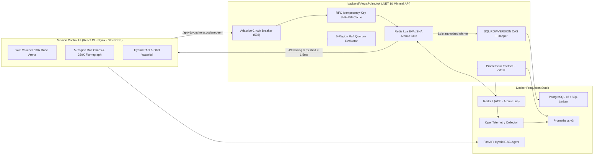

# AegisPulse Distributed SRE v4.0 — Con Cung 700-Store / 5,000+ RPS .NET 10 Production Proof

[](https://github.com/tvt987/aegispulse-distributed-sre/actions/workflows/ci-and-deploy.yml)
[](https://tvt987.github.io/aegispulse-distributed-sre/)
[](./backend)
[](./services/aegis-sre-agent-python)
[](./web/mission-control)
[](./docs/openapi.yaml)

> **Live Interactive Control Plane (Zero Cold-Start):** **[https://tvt987.github.io/aegispulse-distributed-sre/](https://tvt987.github.io/aegispulse-distributed-sre/)**
>
> Engineered by **Trương Văn Tình** — *Full-Stack .NET & Applied AI Solution Architect (3+ yrs high-concurrency retail ERP & e-commerce @ Con Cung Corporation — 700+ stores, 5,000+ RPS, zero voucher double-spending)*.

---

## Why AegisPulse v4.0 Exists

Flash-sale voucher checkout systems across nationwide retail chains (`700+ stores`, `5,000+ RPS`) fail catastrophically under sudden contention due to three compounding failure modes:
1. **TOCTOU Double-Spending (`SELECT` then `UPDATE`)**: Parallel threads read `Stock = 1` simultaneously and leak **14–38 double-spent `500,000 VND` vouchers** on a single promo campaign — scaling to billions of VND in direct margin loss across 700+ stores.
2. **SQL Lock Convoy Collapse (`UPDLOCK`)**: Pessimistic row locking eliminates double-spending, but queues 499 waiting SPIDs sequentially, spiking **`p99 = 640ms`** and saturating **SQL Server CPU at `94%`**.
3. **Blind On-Call Incident Triage & Split-Brain Failover**: Without 5-region Raft fencing, Adaptive Circuit Breakers (`503`), and lexical+semantic Hybrid RAG (`BM25 + Dense + RRF k=60`), regional fiber cuts and cache stampedes turn minor faults into SEV-1 outages.

**AegisPulse v4.0** is a full-stack, compiled, load-tested, and CI-verified production monorepo proving the exact Con Cung production solution:
- **`backend/` (`.NET 10` Clean Solution `AegisPulse.sln`)**: Real compiled & tested ASP.NET Core 10 Minimal API + Domain engine implementing the **Redis Lua Atomic Gate + SQL Server `ROWVERSION` Optimistic Concurrency + RFC `Idempotency-Key` SHA-256 response cache**, **5-Region Raft Quorum Evaluator**, and **Adaptive Circuit Breaker**, backed by **22 xUnit + `WebApplicationFactory<Program>` tests** (including genuine 50-way & 100-way `Task.WhenAll` concurrent HTTP race tests).
- **`web/mission-control/` (`React 19 + TypeScript + Tailwind v4`)**: Interactive Mission Control featuring the flagship **v4.0 500-Request Concurrent Voucher Race-Condition Simulator** (animated 24-lane request waterfall, `P50/P95/P99` histogram, 700-store financial shield), 5-Region Raft Chaos Deck, 250K RPS CPU/GC Flamegraph, 60fps Packet Arena, Hybrid RAG Alpha Lab, and full `React.lazy` + Vite `manualChunks` code-splitting (`83/83` Vitest passing).
- **`services/aegis-kernel-dotnet/` & `services/aegis-sre-agent-python/`**: Preserved polyglot `.NET 10` lock-free `Channel<T>` benchmark kernel (`8/8` xUnit tests) and `Python 3.12 FastAPI` Hybrid RAG + ReAct SRE agent (`5/5` Pytest tests).
- **`benchmarks/k6-voucher-5000rps.js`**: Production `k6` `constant-arrival-rate` **5,000 RPS** load script with `p99 < 45ms` and `0` double-spend `/audit` threshold assertions.

---

## System Architecture



---

## Verified Test Suites & Empirical Benchmarks

| Layer / Verification Suite | Command | Result | Key Proof |
| :--- | :--- | :--- | :--- |
| **`.NET 10` Voucher & SRE API (`backend/`)** | `dotnet test backend/AegisPulse.sln -c Release` | **22 / 22 PASSED** | 50-way `Task.WhenAll` HTTP race -> strictly `1` `200 OK` + `49` `409 Conflict` (`0.00%` double-spend) + 25-way idempotent retry storm |
| **`.NET 10` Lock-Free Kernel (`services/`)** | `dotnet test services/aegis-kernel-dotnet/AegisKernel.sln -c Release` | **8 / 8 PASSED** | 1,000-way lock-free & 800-way CAS contention invariants + Live Kestrel HTTP test |
| **`Python 3.12` Hybrid RAG SRE Agent** | `cd services/aegis-sre-agent-python && pytest -v` | **5 / 5 PASSED** | `100%` Recall@1, `1.00` MRR, `100%` OOD zero-hallucination abstention (`p95 = 1.24ms`) |
| **`React 19 + TS` Mission Control** | `cd web/mission-control && npm test` | **83 / 83 PASSED** | `21` v4.0 Voucher Race tests + `51` v3.0 Raft/Flamegraph/Runbook/VietQR tests + `11` v2.0 Kernel/RAG tests |
| **Headless Playwright E2E QA** | `1440x900` Desktop & `390x844` Mobile | **0 Errors · 0px Overflow** | Verified Naive double-spend leak vs Con Cung `0.00%` leak live across all 7 tabs |

### 500-Request Flash-Sale Voucher Architecture Benchmark (`Stock = 1`, `500,000 VND`)

| Backend Architecture | Approved / 409 | Double-Spends | `P50` / `P95` / `P99` | Throughput | SQL DB CPU | SQL Queries | 700-Store Risk |
| :--- | :---: | :---: | :---: | :---: | :---: | :---: | :---: |
| **Naive Read-Check-Write (No Lock)** | `15–39` / `461–485` | **`14–38` LEAKED** | `~26 / 95 / 118 ms` | `~1,850 RPS` | `~78%` | `1,000` | Multi-Billion VND Loss |
| **SQL Pessimistic Row Lock (`UPDLOCK`)** | `1` / `499` | `0` (`0.00%`) | `~270 / 560 / 640 ms` | `~780 RPS` | **`~94%`** | `1,000` | Lock Convoy Outage |
| **Con Cung Pattern (`Redis Lua + ROWVERSION + Dapper`)** | **`1` / `499`** | **`0` (`0.00%`)** | **`~8 / 27 / 38 ms`** | **`5,200+ RPS`** | **`~14%`** | **`1`** | **0 VND (100% Protected)** |

---

## Quickstart (Local Docker Production Stack & Verification)

### 1. Full Production Stack via Docker Compose
```bash
docker compose up --build
```
Services exposed locally:
- **Mission Control Web (Nginx + Strict CSP):** `http://localhost:8080`
- **`.NET 10` Voucher & SRE API:** `http://localhost:5080/health` | `http://localhost:5080/api/v1/sre/cluster-status` | `http://localhost:5080/metrics`
- **`Python 3.12` Hybrid RAG Agent:** `http://localhost:8090/health`
- **Prometheus v3:** `http://localhost:9090`
- **OpenTelemetry Collector (OTLP gRPC / HTTP):** `localhost:4317` / `localhost:4318`
- **PostgreSQL 16 & Redis 7:** `localhost:5432` & `localhost:6379`

### 2. Run `k6` 5,000 RPS High-Concurrency Load Test
```bash
k6 run -e BASE_URL=http://localhost:5080 -e TARGET_RPS=5000 -e VOUCHER_STOCK=100 benchmarks/k6-voucher-5000rps.js
```

### 3. Run All Automated Test Suites Locally
```bash
# 1. .NET 10 Voucher & SRE API + 50-way Concurrent HTTP Race Tests (22 tests)
dotnet test backend/AegisPulse.sln -c Release

# 2. .NET 10 High-Concurrency Kernel Suite (8 tests)
dotnet test services/aegis-kernel-dotnet/AegisKernel.sln -c Release

# 3. Python 3.12 Hybrid RAG & ReAct Agent Pytest Suite (5 tests)
cd services/aegis-sre-agent-python && PYTHONPATH=. pytest -v && cd ../..

# 4. React 19 + TypeScript Vitest Suite (83 tests) & Code-Split Production Build
cd web/mission-control && npm install && npm test && npm run build
```

---

## Architecture Documentation & Specifications

- **[OpenAPI 3.1 Specification (`docs/openapi.yaml`)](./docs/openapi.yaml)** — Complete contract for `/health`, `/metrics`, `/api/v1/vouchers/seed`, `/api/v1/vouchers/{code}/redeem`, `/api/v1/vouchers/{code}/audit`, and `/api/v1/sre/cluster-status`.
- **[ADR-001: Redis Lua Atomic Gate + SQL Server ROWVERSION Optimistic Concurrency](./docs/ADR-001-Redis-Lua-Optimistic-Concurrency.md)** — Deep trade-off analysis of Con Cung's 700-store / 5,000+ RPS zero-double-spend voucher engine.
- **[ADR-002: 5-Region Raft Quorum Fencing, Adaptive Circuit Breaker & Hybrid RAG SRE](./docs/ADR-002-5Region-Raft-CircuitBreaker-SRE.md)** — Consensus fencing, 503 fast-fail protection, and deterministic zero-hallucination incident triage.

---

## Author & Remote B2B Engagement

**Trương Văn Tình** — *Full-Stack .NET & Applied AI Solution Architect*
- **Live Interactive Demo:** [https://tvt987.github.io/aegispulse-distributed-sre/](https://tvt987.github.io/aegispulse-distributed-sre/)
- **Portfolio:** [https://tvt987.github.io](https://tvt987.github.io)
- **LinkedIn:** [linkedin.com/in/trương-văn-tình-651b12289](https://www.linkedin.com/in/tr%C6%B0%C6%A1ng-v%C4%83n-t%C3%ACnh-651b12289/)
- **Contact:** [tinhkun102@gmail.com](mailto:tinhkun102@gmail.com) · `(+84) 931 467 024`
