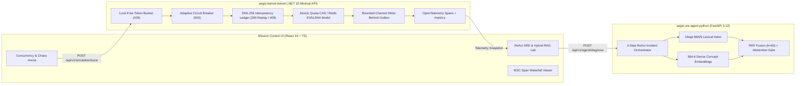

# ⚡ AegisPulse — High-Concurrency Transaction Kernel, Chaos Fault Lab & Autonomous SRE Control Plane

[](https://github.com/tvt987/aegispulse-distributed-sre/actions/workflows/ci-and-deploy.yml)
[](https://tvt987.github.io/aegispulse-distributed-sre/)
[](./services/aegis-kernel-dotnet)
[](./services/aegis-sre-agent-python)
[](./web/mission-control)

> **Live Interactive Control Plane (Zero Cold-Start):** **[https://tvt987.github.io/aegispulse-distributed-sre/](https://tvt987.github.io/aegispulse-distributed-sre/)**
>
> Engineered by **Trương Văn Tình** — *Full-Stack .NET & Applied AI Engineer (3+ yrs high-concurrency retail ERP & e-commerce @ Con Cung Corporation — 700+ stores, 5,000+ RPS)*.

---

## 🎯 Why AegisPulse Exists

Flash-sale checkout and voucher systems fail catastrophically under sudden traffic bursts (`5,000–100,000+ RPS`) due to three compounding failure modes:
1. **TOCTOU Double-Spending (`SELECT` then `UPDATE`)**: Concurrent threads read stale positive stock and oversell inventory into negative balances.
2. **Mobile Retry Storms**: Clients on lossy networks retry timed-out `POST /orders` calls, creating duplicate charges unless protected by deterministic **RFC `Idempotency-Key` SHA-256 payload fingerprinting**.
3. **Blind Incident Triage**: During SEV-1 latency or circuit-breaker incidents, pure dense vector RAG hallucinates or misses exact error codes (`409`, `503`, `RowVersion`, `EVALSHA`).

**AegisPulse** solves all three in a unified, empirically benchmarked polyglot monorepo:
- **`services/aegis-kernel-dotnet` (C# / .NET 10)**: Side-by-side implementation of **Naive Unprotected**, **Optimistic `RowVersion` CAS**, and **Aegis Lock-Free Atomic Quota + `System.Threading.Channels` Write-Behind WAL**, guarded by a lock-free **Sliding-Window Token Bucket (`429`)** and **Adaptive Circuit Breaker (`503` Closed → Open → Half-Open)** with microsecond W3C trace spans and Prometheus `/metrics`.
- **`services/aegis-sre-agent-python` (Python 3.12 / FastAPI)**: Deterministic **Okapi BM25 (`k1=1.5, b=0.75`) + 384-d Dense Cosine + Reciprocal Rank Fusion (`RRF k=60`)** Hybrid RAG engine with a **100%-precision Zero-Hallucination Abstention Gate** and a **3-step ReAct Incident Co-Pilot**.
- **`web/mission-control` (React 19 / TypeScript / Tailwind v4)**: Interactive Mission Control featuring a Dual-Runtime Adapter (connects automatically to local/Docker `.NET 10` + `FastAPI` clusters, and runs a faithful in-browser deterministic port at `<1ms` latency on GitHub Pages CDN).

---

## 🏗️ System Architecture



---

## 📊 Empirical Benchmark Results (Verified in CI)

### 1. `.NET 10` High-Concurrency Flash-Sale Kernel (`benchmarks/dotnet-benchmark-report.json`)
*10,000 concurrent async requests contending for 500 flash-sale inventory units (`20%` duplicate retry storm):*

| Concurrency Engine | Burst Load | Throughput | `p50` | `p99` | Double-Spend Leaks | Stock Invariant |
| :--- | ---: | ---: | ---: | ---: | ---: | :--- |
| **Naive Read-Then-Write** *(Anti-Pattern)* | 2,500 | 101,221 RPS | 0.003 ms | 14.348 ms | **`+471` LEAKED** | ❌ `BREACHED` |
| **Optimistic `RowVersion` CAS + Idempotency** | 10,000 | **139,099 RPS** | 0.006 ms | **0.043 ms** | **`0`** | ✅ `INTACT` |
| **Aegis Lock-Free Atomic + `Channel<T>` WAL** | 10,000 | **100,315 RPS** | 0.006 ms | **0.061 ms** | **`0`** *(only 3 CAS spins)* | ✅ `INTACT` |

### 2. `Python 3.12` Hybrid RAG & Abstention Guardrail (`benchmarks/python-rag-eval-report.json`)

| Metric | Result | Notes |
| :--- | ---: | :--- |
| **Golden Technical `Recall@1`** | **`100%` (`1.00`)** | 10/10 exact top-1 runbook retrieval |
| **Golden Technical `Recall@3`** | **`100%` (`1.00`)** | 10/10 grounded runbook coverage |
| **Mean Reciprocal Rank (`MRR`)** | **`1.00`** | RRF (`k=60`) fusing BM25 + 384-d cosine |
| **Adversarial Out-of-Domain Abstention** | **`100%` (`1.00`)** | 0 hallucinations across 5 OOD trap prompts |
| **`p95` Retrieval Latency** | **`1.238 ms`** | Zero external paid LLM API dependency |

---

## 🚀 Quickstart (Local Polyglot Stack or Docker Compose)

### Option A — Docker Compose (All 3 Services)
```bash
docker compose up --build
# .NET 10 Kernel API:    http://localhost:5080/health  | Prometheus: http://localhost:5080/metrics
# Python SRE RAG API:    http://localhost:8090/health
# Mission Control Web:   http://localhost:5173
```

### Option B — Run All Automated Test Suites & Benchmarks Directly
```bash
# 1. .NET 10 xUnit Concurrency & Live Kestrel HTTP Integration Suite (8/8 tests)
dotnet test services/aegis-kernel-dotnet/AegisKernel.sln -c Release

# 2. Python 3.12 Hybrid RAG & ReAct Agent Pytest Suite (5/5 tests)
cd services/aegis-sre-agent-python && PYTHONPATH=. pytest -v && cd ../..

# 3. React 19 + TypeScript Vitest & Production Build
cd web/mission-control && npm install && npm test && npm run build
```

---

## 👨‍💻 Author & Remote B2B Engagement

**Trương Văn Tình** — *Full-Stack .NET & Applied AI Engineer*
- **Live Interactive Demo**: [https://tvt987.github.io/aegispulse-distributed-sre/](https://tvt987.github.io/aegispulse-distributed-sre/)
- **Portfolio**: [https://tvt987.github.io](https://tvt987.github.io)
- **LinkedIn**: [linkedin.com/in/trương-văn-tình-651b12289](https://www.linkedin.com/in/tr%C6%B0%C6%A1ng-v%C4%83n-t%C3%ACnh-651b12289/)
- **Contact**: [tinhkun102@gmail.com](mailto:tinhkun102@gmail.com) · `(+84) 931 467 024`
